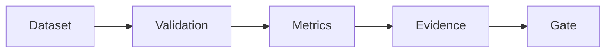

# evalOps

**Ship AI with evidence.**

Local-first evaluation engineering for LLM applications, retrieval systems and agents.

  [](https://github.com/ops-universe/evalOps/actions/workflows/ci.yml)

> Development source repository. Public release is deferred. See [implementation status](docs/status/IMPLEMENTATION-STATUS.md) for scoped evidence and limitations.

## Why evalOps?

Evaluate supplied outputs reproducibly before accepting a change. Keep evidence, absolute quality gates and regression comparisons separate from model execution.

## Features

- Versioned datasets and deterministic exact, normalized-exact and JSON structural metrics.
- Unsigned evidence reports and strict suite-compatible regression comparison.
- Opt-in rubric judging and calibration; offline RAG and agent trace evaluation.
- Multi-suite CI gates, baseline management and synthetic dashboard/scenarios.

## Architecture



[Architecture](docs/architecture/overview.md) · [Regression](docs/architecture/regression.md) · [Judge](docs/architecture/judge.md)

## Quickstart

Requires Node.js 22+ and npm. Work from the repository root; the package is private and not presented as an npm release.

```sh
git clone https://github.com/ops-universe/evalOps.git
cd evalOps
npm ci
npm test
npm run demo
```

## CLI and examples

Use synthetic fixtures only.

```sh
node src/cli.mjs --help
```

## Configuration

Dataset schemas and gate configuration are documented in [dataset and evidence contracts](docs/architecture/datasets-and-evidence.md). External model judging requires explicit opt-in and a trusted adapter; see [judge configuration](docs/architecture/judge.md).

## Additional evaluation workflows

### CLI and evidence

```sh
node src/cli.mjs validate datasets/synthetic.json
node src/cli.mjs run datasets/synthetic.json --min-pass-rate 0.75 --out evidence.json
```

The CLI exits 0 on pass, 1 on failed gate, 2 on invalid input or I/O error. Existing reports are never overwritten. Versioned schemas live in `schemas/`; see [dataset and evidence contracts](docs/architecture/datasets-and-evidence.md). Reports include a reproducible dataset SHA-256, not a signed attestation. Do not publish sensitive IDs or hashes.

### Regression comparison

Additional deterministic metrics: `normalized-exact` (NFC, whitespace normalization and lowercase) and `json-equal` (parsed JSON structural equality, object key order ignored, array order preserved, depth limit 100). Invalid JSON fails; JavaScript number precision and duplicate JSON keys follow JSON.parse semantics. These are not semantic metrics.

```sh
node src/cli.mjs compare baseline.json current.json --out regression.json
```

Generate both evidence files with the updated evaluator. Comparison requires matching suite fingerprints (case IDs, metrics and expected text), validates evidence totals, detects per-case regressions even when aggregate scores are unchanged, and blocks on any regression, score drop or failed current absolute gate. The API supports explicit tolerances; CLI defaults are strict. Evidence is unsigned and must come from trusted runs. Old reports without a suite fingerprint must be regenerated.

### Optional model-assisted judging

Run the offline synthetic fixture: `node examples/judge-demo.mjs`. The fixture does not evaluate semantic quality. Use `judgeCase` with a trusted rubric, adapter and explicit policy. A configurable HTTPS Chat Completions adapter is provided, but no live provider compatibility is verified. External calls require both opt-in flags and transmit case text. See [judge architecture and calibration](docs/architecture/judge.md).

## Scope and limitations

Offline synthetic evidence and trusted local inputs/adapters only. Evidence is unsigned. Live provider compatibility and independent semantic verification are not established. Public release and Developer Preview launch remain deferred.

Read the [threat model](docs/security/threat-model.md) before integrating with real data or systems.

## Roadmap

See [ROADMAP.md](ROADMAP.md) and [implementation status](docs/status/IMPLEMENTATION-STATUS.md). Developer Preview launch and public release remain deferred.

## Contributing and support

Read [CONTRIBUTING.md](CONTRIBUTING.md), [Code of Conduct](CODE_OF_CONDUCT.md), and [SECURITY.md](SECURITY.md). Open a focused [issue](https://github.com/ops-universe/evalOps/issues) with a minimal synthetic reproduction or documentation proposal. Run `npm ci` and `npm test` before opening a focused PR. Report security concerns using the security policy rather than public issues.

## Related projects

[guardOps](https://github.com/ops-universe/guardOps) · [ragOps](https://github.com/ops-universe/ragOps) · [traceOps](https://github.com/ops-universe/traceOps) · [mcpOps](https://github.com/ops-universe/mcpOps) · [workflowOps](https://github.com/ops-universe/workflowOps) · [dataOps](https://github.com/ops-universe/dataOps) · [Ops Universe](https://github.com/ops-universe)

## License

[MIT](LICENSE)

Support: [GitHub Sponsors](https://github.com/sponsors/AnkitParekh007) · [Buy me a coffee](https://buymeacoffee.com/ankitparekh).
